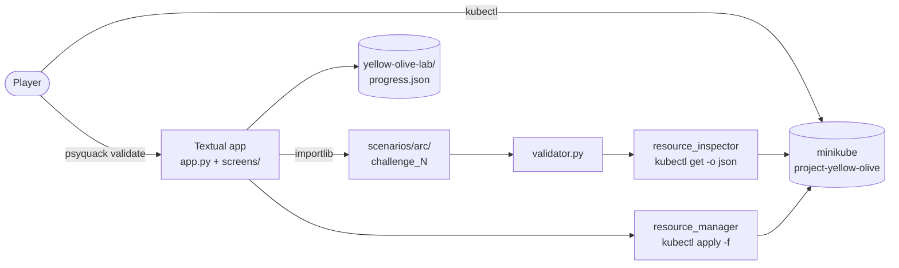

<div class="grid grid-cols-[1.25fr_1fr] gap-8 h-full items-center">
<div>
<div class="pixel green text-xs mb-4">PYCON TAIWAN 2026 · R2 · SUN 18 OCT · 10:50</div>
<h1 style="font-size:1.9rem">Pods, Probes, and Play</h1>
<div class="text-2xl font-bold mb-6">Gamifying Kubernetes with Python</div>
<div class="panel">
<div class="gold font-bold text-lg">Anubhav Sanyal</div>
<div class="dim mono text-sm">Creator of Project Yellow Olive · github.com/Anubhav9</div>
</div>
<div class="pixel gold text-sm mt-8 blink">▶ PRESS START</div>
</div>
<div class="text-center">


</div>
</div>

<!--
[PRESS START · ~1 min total with the next slide]

Hi everyone, and thank you for being here on a Sunday morning. I'm Anubhav, and I build Project Yellow Olive, an open-source terminal game that teaches Kubernetes on a real cluster.

Over the next 35 minutes or so, I want to show you what happens when you treat Kubernetes learning as a game design problem rather than a documentation problem. And I want to show you how much of that game is just ordinary Python.

[TODO for Anubhav: add one personal line here, such as your role or where you work.]
-->

---

<div class="level">
<div class="tag">LEVEL 01</div>
<div class="title">THE PROBLEM</div>
<div class="sub">Why does Kubernetes feel hard to learn?</div>
<div class="hp w-80 mt-10"><div style="width:22%"></div></div>
<div class="pixel dim text-xs mt-2">LEARNER HP</div>
</div>

<!--
[LEVEL 01 · THE PROBLEM · ~5 min for slides 2–5]

Let's start with the problem. If you've learned Kubernetes, or tried to teach it to someone, you probably know this feeling. The learner's HP bar drops quickly, and it isn't because the people are not smart. It's because of how the learning path is shaped.
-->

---

# The copy-YAML learning path

<div class="grid grid-cols-5 gap-3 mt-10 items-stretch">
<div class="panel text-center"><div class="text-3xl">📖</div><div class="font-bold mt-2">Read docs</div><div class="dim text-sm">concept pages</div></div>
<div class="panel text-center"><div class="text-3xl">📋</div><div class="font-bold mt-2">Copy YAML</div><div class="dim text-sm">from a tutorial</div></div>
<div class="panel text-center"><div class="text-3xl">⌨️</div><div class="font-bold mt-2">kubectl apply</div><div class="dim text-sm">"created"</div></div>
<div class="panel text-center"><div class="text-3xl">✅</div><div class="font-bold mt-2">Move on</div><div class="dim text-sm">next page</div></div>
<div class="panel panel-gold text-center"><div class="text-3xl">❓</div><div class="font-bold mt-2 gold">Did I learn?</div><div class="dim text-sm">no feedback</div></div>
</div>

<v-click>

<div class="mt-12 text-xl text-center">The loop has <span class="gold font-bold">input</span>, but almost no <span class="green font-bold">feedback</span>.</div>

</v-click>

<!--
This is the path many of us follow. Read a concept page. Copy a YAML file from a tutorial. Run kubectl apply. See "created". Move on to the next page.

[click] The problem is that this loop has plenty of input, but almost no feedback. Nothing tells you whether you understood what you just did. You memorise commands, but you don't build a mental model of how the cluster behaves.
-->

---

# "created" is not "working"

<div class="grid grid-cols-2 gap-6 mt-6">
<div>

```bash
$ kubectl apply -f pod-q1.yaml
pod/electromon-pod created
```

<div class="caption">What the command tells you</div>

</div>
<div>

```bash
$ kubectl get pods -n oakwood-meadows
NAME             READY   STATUS   RESTARTS
electromon-pod   0/1     Error    4 (53s ago)
```

<div class="caption">What the cluster is actually doing</div>

</div>
</div>

<v-click>

<div class="panel panel-gold mt-10 text-lg">
Kubernetes is declarative: you describe the state you want, and the controllers try to make it happen. <br/>
The useful learning happens in the <span class="gold font-bold">gap between what you asked for and what actually happened</span>.
</div>

</v-click>

<!--
Here's a concrete example, taken from a real run of the game on minikube. kubectl apply says "created". That's true: the API server accepted the object.

But if you look a minute later, the Pod is in Error and has restarted four times.

[click] Kubernetes is declarative. You describe the state you want, and the controllers try to make it happen. The useful learning happens in the gap between what you asked for and what actually happened. Most tutorials never make you sit in that gap.
-->

---

# Why I built this

<div class="grid grid-cols-[1fr_1.3fr] gap-10 mt-6 items-center">
<div class="text-center">

<div class="caption">Professor Bald, the mentor in the game</div>
</div>
<div>

<div class="panel panel-gold text-lg leading-relaxed">
"I've attempted the CKAD and CKA certifications - and I didn't clear them.<br/><br/>
Not because I didn't understand the concepts, but because <span class="gold font-bold">I didn't practice enough</span>."
</div>
<div class="caption">From the Yellow Olive README · "An Honest Take"</div>

<div class="mt-4">"This project isn't a replacement for serious exam prep. It's a <span class="green font-bold">practice ground</span>."</div>

<div class="mt-6 text-lg">So I asked myself one question 👉</div>

</div>
</div>

<!--
[TODO for Anubhav: tell this story in your own words. It's the most human slide in the talk.]

This is straight from the Yellow Olive README. I attempted the CKAD and the CKA, and I didn't clear them. It wasn't because I didn't understand the concepts. It was because I didn't practise enough. Consistency and repetition are hard when the practice feels like a chore.

So I wanted a practice ground: somewhere to build confidence and keep the adrenaline a little elevated while solving real problems. It's not a replacement for serious exam prep. It's a reason to come back tomorrow.
-->

---

<div class="level">
<div class="tag">LEVEL 02</div>
<div class="title">ENTER<br/>YELLOW OLIVE</div>
<div class="sub text-2xl mt-4 max-w-3xl">What would Kubernetes learning look like<br/>if it were <span class="gold font-bold">designed like a game</span>?</div>
</div>

<!--
[LEVEL 02 · ENTER YELLOW OLIVE · ~5 min for slides 6–11]

So here's the question that the rest of this talk tries to answer: what would Kubernetes learning look like if it were designed like a game?

Games are very good at the thing tutorials are bad at. They give you a goal, let you act, show you the consequence right away, and then give you a slightly harder goal. Let me show you my attempt.
-->

---

# The game in one screen

<div class="grid grid-cols-[1.5fr_1fr] gap-6 mt-2 items-center">
<div>

<div class="caption">Real screenshot: Challenge 1 on a live minikube cluster</div>
</div>
<div>

- Open-source **retro terminal game**
- `pip install yellow-olive`
- Built with **Textual + Rich**
- Runs against a **real minikube cluster**
- **24 challenges** in 4 story arcs
- You fix things with real **`kubectl`**

</div>
</div>

<!--
This is Yellow Olive. It's an open-source terminal game, and you can install it from PyPI with pip install yellow-olive. The UI is built with Textual and Rich.

The important part: there is no simulator. When you start the game, it starts a real minikube cluster, puts broken resources into it, and asks you to fix them with the real kubectl. There are 24 challenges, spread across four story arcs.
-->

---

# The World Dex

<div class="grid grid-cols-2 gap-8 mt-6">
<div>

| In the game | In Kubernetes |
|---|---|
| **Posemon** | Container |
| **Pokepod** | Pod |
| **Town** | Namespace |
| **Command Chamber** | Your terminal running `kubectl` |
| **`psyquack validate`** | "Check my cluster now" |
| **Meow Coins** | Progress reward |

</div>
<div class="flex flex-col justify-center gap-4">

<div class="caption">Real prologue text: "PokePods carry Posemons safely… Towns define your territory."</div>
</div>
</div>

<!--
Every game needs a world. Ours maps directly onto Kubernetes. A Posemon is a container. A Pokepod is a Pod, the thing that carries containers. A Town is a namespace.

Your Command Chamber is just your normal terminal where you run kubectl. When you think you've fixed something, you type psyquack validate in the game. And yes, you earn Meow Coins.

Notice that the game always says the real name in brackets. The metaphor is a way in, but we never hide the real vocabulary.
-->

---

# The cast

<div class="grid grid-cols-4 gap-5 mt-4 text-center">
<div class="panel"><div class="gold font-bold mt-2">Professor Bald</div><div class="dim text-sm">mentor, explains the mission</div></div>
<div class="panel"><div class="gold font-bold mt-2">PsyQuack</div><div class="dim text-sm">your companion, reacts to validation</div></div>
<div class="panel"><div class="gold font-bold mt-2">Electromon</div><div class="dim text-sm">the first Posemon you rescue</div></div>
<div class="panel"><div class="gold font-bold mt-2">Team Evil</div><div class="dim text-sm">the villains in the RBAC arc</div></div>
</div>
<div class="grid grid-cols-3 gap-5 mt-5 text-center w-3/4 mx-auto">
<div class="panel"><div class="gold font-bold mt-1">The Mayor</div></div>
<div class="panel"><div class="gold font-bold mt-1">Hana</div></div>
<div class="panel"><div class="gold font-bold mt-1">Cool Turtle</div></div>
</div>

<!--
Characters do real work in a learning game. Professor Bald frames each mission, so you know why it matters before you know how to do it. PsyQuack is your companion: he reacts when validation passes or fails, which makes a red error feel less like a punishment.

Electromon is the first Posemon you rescue. Team Evil shows up in the RBAC arc, where you need to lock them out of a vault.

[TODO for Anubhav: add a line about Hana, the Mayor and Cool Turtle in your own words.]
-->

---

# Four arcs · 24 challenges

<div class="grid grid-cols-4 gap-4 mt-6">
<div class="panel"><div class="pixel text-xs green">ARC 1 · 1–7</div><div class="gold font-bold text-lg mt-2">Oakwood Meadows</div><div class="text-sm mt-2">Pods, liveness probes, resource limits, the basics of a workload</div></div>
<div class="panel"><div class="pixel text-xs green">ARC 2 · 8–13</div><div class="gold font-bold text-lg mt-2">Signal Town</div><div class="text-sm mt-2">Services, DNS, endpoints, NodePort, Ingress</div></div>
<div class="panel"><div class="pixel text-xs green">ARC 3 · 14–19</div><div class="gold font-bold text-lg mt-2">Gold Rush City</div><div class="text-sm mt-2">ServiceAccounts, Roles, RoleBindings, ClusterRoles, <code>auth can-i</code></div></div>
<div class="panel"><div class="pixel text-xs green">ARC 4 · 20–24</div><div class="gold font-bold text-lg mt-2">Sakura Harbour</div><div class="text-sm mt-2">Deployments, replicas, labels, rolling updates, canary-style releases</div></div>
</div>

<div class="mt-10 text-center text-lg">Each town is a <span class="gold font-bold">namespace</span>. Each arc adds one new layer of Kubernetes.</div>

<!--
The campaign has four arcs and 24 challenges. Oakwood Meadows is about Pods: getting a container running, adding a liveness probe, setting resource limits. Signal Town is networking: Services, DNS, endpoints, NodePort and Ingress. Gold Rush City is access control with RBAC. Sakura Harbour is Deployments and rollouts.

Each town is literally a namespace on the cluster. And the difficulty curve is a game design choice: every arc adds exactly one new layer on top of the last one.
-->

---

# Two terminals, one cluster

<div class="grid grid-cols-2 gap-5 mt-2">
<div>
<div class="pixel text-xs gold mb-2">GAME WINDOW</div>

<div class="caption">Mission, dialogue, <code>psyquack validate</code></div>
</div>
<div>
<div class="pixel text-xs green mb-2">COMMAND CHAMBER</div>

<div class="caption">Plain bash + kubectl: inspect, edit, re-apply</div>
</div>
</div>

<div class="mt-5 text-center">The game <span class="gold font-bold">never types for you</span>. You do the work in a real shell, and the game checks the result.</div>

<!--
This is the most important design decision in Yellow Olive. There are two terminals. On the left is the game window: the mission, the dialogue, and the place where you type psyquack validate. On the right is the Command Chamber, which is just a normal shell with kubectl.

The game never types commands for you. The skills you practise in the Command Chamber are exactly the skills you'll use at work. The game's job is to set the challenge and judge the result.
-->

---

<div class="level">
<div class="tag">LEVEL 03</div>
<div class="title">THE GAME LOOP</div>
<div class="sub">One challenge, from mission to reward</div>
</div>

<!--
[LEVEL 03 · THE GAME LOOP · ~7 min for slides 12–17]

Let's zoom in on the core loop, and walk through one real challenge from start to finish.
-->

---

# Mission → Feedback → Next

<div class="grid grid-cols-[repeat(11,auto)] gap-2 mt-14 items-center justify-center">
<div class="loop-node">MISSION</div><div class="arrow">▶</div>
<div class="loop-node" v-click>ACTION</div><div class="arrow" v-click="2">▶</div>
<div class="loop-node" v-click="2">CLUSTER<br/>CHANGE</div><div class="arrow" v-click="3">▶</div>
<div class="loop-node" v-click="3">VALIDATION</div><div class="arrow" v-click="4">▶</div>
<div class="loop-node" v-click="4">FEEDBACK</div><div class="arrow" v-click="5">▶</div>
<div class="loop-node" v-click="5" style="border-color:var(--yo-green)">NEXT<br/>CHALLENGE</div>
</div>

<div class="grid grid-cols-5 gap-3 mt-10 text-sm text-center dim">
<div>Story + objective<br/>from the challenge</div>
<div v-click="1">You run <code>kubectl</code> in the Command Chamber</div>
<div v-click="2">Real objects change on minikube</div>
<div v-click="3"><code>validator.py</code> reads the live state</div>
<div v-click="4">PsyQuack reacts, then you unlock the next challenge or retry</div>
</div>

<!--
Here's the loop that every challenge follows.

It starts with a mission: a bit of story and a clear objective.
[click] Then there's an action. You go to the Command Chamber and do something with kubectl.
[click] That action causes a real cluster change. Real objects change on minikube.
[click] When you're ready, you ask for validation. A Python validator reads the live cluster state.
[click] You get feedback: PsyQuack is either thrilled or disappointed, and the message tells you what's wrong.
[click] And then you unlock the next challenge, or you go back and try again. This loop is the whole game.
-->

---

# Challenge 1: the mission

<div class="grid grid-cols-[1.4fr_1fr] gap-6 items-center">
<div>

</div>
<div>
<div class="panel">
<div class="pixel text-xs gold">OBJECTIVE</div>

- Namespace: `oakwood-meadows`
- Inspect `pod-q1.yaml` in your lab folder
- Fix the issue
- Delete and recreate the Pod
- Type `psyquack validate`

</div>
<div class="caption mt-3">Manifests are copied into <code>yellow-olive-lab/</code> so players can edit them.</div>
</div>
</div>

<!--
Challenge 1 is the first real battle. Electromon is stuck inside its Pokepod. The objective is very concrete: look in the oakwood-meadows namespace, inspect the manifest in your lab folder, fix it, recreate the Pod, and then validate.

One small detail I like: the manifests live in a folder called yellow-olive-lab in your working directory. They're real files you open in your own editor. They aren't hidden inside the package.
-->

---

# Challenge 1: find the bug, fix the bug

<div class="grid grid-cols-2 gap-6 mt-2">
<div>

```yaml {6}
spec:
  containers:
    - name: elctromon-container
      image: nginx
      command:
        - "/bin/sh"
        - "-c"
        - "sleeeep 10000"
```

<div class="caption">The real shipped manifest: the typo is the challenge</div>
</div>
<div>

```bash
$ kubectl get pods -n oakwood-meadows
electromon-pod   0/1   Error   4

$ sed -i 's/sleeeep/sleep/' pod-q1.yaml
$ kubectl delete pod electromon-pod -n oakwood-meadows
$ kubectl apply -f pod-q1.yaml
$ kubectl get pods -n oakwood-meadows
electromon-pod   1/1   Running   0
```

<div class="caption">One possible fix, taken from the demo recording</div>
</div>
</div>

<div class="mt-4 text-center">Small bug, real lessons: <b>Pods are immutable here</b>, so you have to <b>delete and recreate</b>, and <b>a status is a clue</b>.</div>

<!--
Here's the actual manifest the game ships. Look at the command: "sleeeep" with three e's. The shell can't find that command, so the container exits, Kubernetes restarts it, and you get Error and then CrashLoopBackOff.

On the right is one way to fix it, taken from my demo recording. I used sed, but you could just as well open vim, VS Code, or anything else. Then you delete the Pod and apply it again, because you can't change the container command of a running Pod.

It's a tiny bug, but you learn three real things: status is a clue, Pods are immutable here, and delete-then-apply is a normal workflow.
-->

---

# Validation & feedback

<div class="grid grid-cols-2 gap-5">
<div>
<div class="pixel text-xs red mb-2">✗ BEFORE THE FIX</div>

<div class="caption">"Electromon's Pokepod is not ready yet. Inspect the manifest…"</div>
</div>
<div>
<div class="pixel text-xs green mb-2">✓ AFTER THE FIX</div>

<div class="caption">"Electromon is out of the Pokepod and ready for adventure."</div>
</div>
</div>

<!--
When you type psyquack validate, the game runs the validator for that challenge against the live cluster.

On the left is what happened when I validated before fixing anything. PsyQuack's feathers droop, and the validator's message points you back at the manifest. You type psyquack back to return to the challenge.

On the right is after the fix: PsyQuack's eyes light up, you get Meow Coins, and the next challenge unlocks. Both screens are real screenshots from the same run.
-->

---

# Why this is not a quiz

<div class="grid grid-cols-2 gap-6 mt-6">
<div class="panel">
<div class="pixel text-xs red">A QUIZ</div>

- Checks the **answer you typed**
- One correct string
- Feedback is "right" or "wrong"
- The world doesn't change

</div>
<div class="panel panel-gold">
<div class="pixel text-xs green">YELLOW OLIVE</div>

- Checks the **state of the cluster**
- Any valid fix passes: sed, vim, `kubectl edit`…
- Feedback explains what's wrong
- Your mistakes really happen on the cluster

</div>
</div>

<div class="mt-8 text-center text-lg">The validator asks "<span class="gold">is the Pod ready?</span>", not "<span class="dim">did you type the right command?</span>"</div>

<!--
This is the difference that matters to me. A quiz checks what you typed. There's one correct string, and the world doesn't change.

Yellow Olive checks the state of the cluster. It doesn't care how you fixed it. You can use sed, vim, kubectl edit, or a completely different approach. If the Pod is ready, you pass. And if you make a mistake, it really happens on the cluster, so you debug it exactly as you would at work.
-->

---

<div class="level">
<div class="tag">LEVEL 04</div>
<div class="title">UNDER THE HOOD</div>
<div class="sub">How Python powers the game</div>
</div>

<!--
[LEVEL 04 · UNDER THE HOOD · ~10 min for slides 18–23]

Now for the PyCon part. Let's look at how Python makes all of this work.
-->

---

# Stack & architecture

<div class="grid grid-cols-[1fr_1.7fr] gap-6">
<div class="text-sm">

- **Textual**: screens, inputs, focus, async workers
- **Rich**: panels, colours, half-block ASCII portraits
- **pygame-ce**: background music and sound effects
- **kubectl + minikube**: dedicated profile `project-yellow-olive`
- **Sentry SDK**: opt-in diagnostics only
- Python **3.10 → 3.15**

</div>
<div>



</div>
</div>

<!--
Here's the stack. Textual handles the screens, inputs, focus and async workers. Rich does the styling, including the character portraits, which are images converted to coloured half-block characters. pygame-ce plays the music. The cluster is minikube with its own profile, so it won't touch your other clusters. Sentry is there for diagnostics, but only if the player opts in.

On the right is the architecture. The player talks to two things: the cluster, through kubectl, and the game, through psyquack validate. The game loads the challenge module, runs its validator, and the validator reads the cluster through a small inspector service. A separate resource manager applies the challenge manifests. Progress is saved to a JSON file.
-->

---

# The input handler: one command, one loop

```python {all|5-8|10-11|13-16}
# screens/common/base_challenge_screen.py
@on(Input.Submitted)
async def handle_validation(self, event: Input.Submitted):
    player_response = (event.value or "").strip().lower()
    if player_response != "psyquack validate":
        general_utils.show_invalid_command(self)
        log.write(general_utils.invalid_command_text("psyquack validate"))
        return

    log.write(challenge_screen_prompts.building_connection_text())
    is_correct, validation_message = self.run_validation()

    log.write(validation_message)
    if is_correct:
        general_utils.update_progress(active_challenge_id=next_id)
        ...  # mount PsyQuackSuccessScreen, else PsyQuackFailureScreen
```

<div class="caption">Trimmed from the real file. One shared screen class drives all 24 challenges.</div>

<!--
Here's the heart of the game loop in Textual. It's one event handler on a shared base screen that every challenge uses.

[click] First, the game accepts exactly one command. Anything else gets a friendly "invalid command" message. Keeping the game vocabulary tiny is deliberate: all the real complexity lives in kubectl.

[click] Then it runs the validator for the current challenge.

[click] If it passes, we save progress and show the success screen. If not, we show PsyQuack's failure screen. That's the whole loop: mission, validation, feedback, next.
-->

---

# Reading the cluster: kubectl → JSON → dict

<div class="grid grid-cols-[1.6fr_1fr] gap-5">
<div>

```python
# services/resource_inspector.py
def _run_kubectl(args, timeout=DEFAULT_TIMEOUT_SECONDS):
    try:
        result = subprocess.run(["kubectl", *args],
            capture_output=True, text=True, timeout=timeout)
        return result.returncode, result.stdout, result.stderr, False
    except subprocess.TimeoutExpired:
        return None, "", "", True

def _fetch_resource(kind, name, namespace, ...):
    rc, out, err, timed_out = _run_kubectl(
        ["get", kind, name, "-n", namespace, "-o", "json"])
    ...
    return True, json.loads(out)   # (ok, dict_or_error)

def get_pod(name, namespace):
    return _fetch_resource("pod", name, namespace)
```

</div>
<div class="panel panel-gold text-sm">
<div class="pixel text-xs gold mb-2">HONEST NOTE</div>

My proposal mentioned the **Kubernetes Python client**. Today, Yellow Olive uses **`kubectl` from Python instead**:

- same tool and kubeconfig as the player
- read-only `get`, plus `auth can-i`
- returns plain dicts, which are easy to test

</div>
</div>

<!--
How does Python read the cluster? This might surprise you. The proposal for this talk mentioned the official Kubernetes Python client. When I built it, I went with something simpler: a tiny wrapper that runs kubectl with subprocess, asks for JSON output, and turns it into a plain dict.

Every call returns a tuple: ok, plus either the data or a readable error. Timeouts are handled, so a slow cluster never freezes the UI.

Why kubectl? It's the same tool and kubeconfig the player uses, so what the game sees is exactly what you see. It's read-only here. And plain dicts are very easy to test. Moving to the Python client later is an option, but this works and it's easy to explain.

[TODO for Anubhav: confirm this rationale matches your own reasons.]
-->

---

# A validator is just a function

```python {all|5-7|9-12|14-17|19}
# scenarios/oakwood_meadows/challenge_1/validator.py
def validate():
    pod_name = challenge_constants.CHALLENGE_1_POD_NAME
    namespace = challenge_constants.NAMESPACE_OAKWOOD_MEADOWS

    ok, pod = resource_inspector.get_pod(pod_name, namespace)
    if not ok:
        return False, "Pokepod not found. Is Electromon deployed in this namespace?"

    container_statuses = pod.get("status", {}).get("containerStatuses", [])
    if not container_statuses:
        return False, "Electromon's Pokepod has no container status yet. " \
                      "Give it a moment, then try again."

    is_ready = container_statuses[0].get("ready") is True
    if not is_ready:
        return False, "Electromon's Pokepod is not ready yet. " \
                      "Inspect the manifest and fix the issue."

    return True, "Electromon is out of the Pokepod and ready for adventure."
```

<div class="caption">Contract: <code>validate() -> (bool, message)</code>. Each early return is a hint written as feedback.</div>

<!--
And here is a complete validator, the real one for Challenge 1. It's just a function that returns a boolean and a message.

[click] Does the Pod exist? If not, say so.
[click] Does it have a container status yet? If not, tell the player to wait a moment.
[click] Is the container ready? If not, point them back at the manifest.
[click] Otherwise, success.

This early-return style matters for learning. Each return is a separate failure mode with its own message, so the feedback gets more specific as the player gets closer. That's how the game gives hints today: through the objective text, the mentor's dialogue, and these validator messages. A dedicated psyquack hint command is on the roadmap, but it isn't wired into the game yet.
-->

---

# Plug-in challenges, save & resume

<div class="grid grid-cols-2 gap-6">
<div>

```python
# base_challenge_screen.py
validator_module = importlib.import_module(
    f"scenarios.{scenario}.challenge_{self.challenge_id}.validator"
)
return validator_module.validate()
```

```json
// yellow-olive-lab/progress.json (real, after Ch 1)
{
  "version": 1,
  "player_name": "Anubhav",
  "active_challenge_id": "2",
  "challenge_background_music": false
}
```

</div>
<div class="text-sm">

<div class="pixel text-xs gold mb-2">CLUSTER LIFECYCLE</div>

1. Lab check: Python, Docker, minikube, kubectl
2. `minikube start -p project-yellow-olive` (300 s budget)
3. Bootstrap town namespaces
4. Copy manifests to `yellow-olive-lab/` (**never overwrites player edits**)
5. `kubectl apply -f` the current challenge
6. Quit → delete the minikube profile

<div class="mt-4">Restart the game → it reads <code>progress.json</code> and <b>resumes at the saved challenge</b>.</div>

</div>
</div>

<!--
Two more pieces of Python make this a game rather than a script.

First, challenges are plug-ins. The shared screen builds a module path from the arc and challenge number, and loads it with importlib. Adding a challenge means adding a folder with a screen, a manifest and a validator. You don't touch the core.

Second, state. Progress is a small JSON file in the lab folder. This is the real file after I finished Challenge 1 in the demo. If you quit, the game deletes its minikube profile to free your laptop's resources. When you come back, it starts a fresh cluster, reads progress.json, and drops you back at the same challenge. The lab folder is never overwritten, so your edits survive.

Cluster startup has a five-minute budget, because minikube on a conference laptop can be slow. That's also why I have a recording ready.
-->

---

# More battles: probes, limits, services

<div class="grid grid-cols-3 gap-4">
<div class="panel">
<div class="pixel text-xs green">CH 2 · LIVENESS PROBE</div>

```yaml
livenessProbe:
  httpGet:
    path: /
    port: 80
```

<div class="text-xs dim">Validator checks the probe is configured on <code>/</code> and port 80</div>
</div>
<div class="panel">
<div class="pixel text-xs green">CH 6 · RESOURCE LIMITS</div>

```yaml
resources:
  limits:
    cpu: "500m"
    memory: "256Mi"
```

<div class="text-xs dim">Validator checks the exact CPU and memory limits</div>
</div>
<div class="panel">
<div class="pixel text-xs red">CH 8 · BROKEN SERVICE</div>

```yaml
type: ClosterIP          # typo
selector:
  app: bulba-baby-wrong  # matches nothing
ports:
  - port: 8080           # wrong
```

<div class="text-xs dim">Validator checks type, selector, ports <b>and that ready endpoints exist</b></div>
</div>
</div>

<!--
[LEVEL 05 · MORE BATTLES · ~5 min for slides 24–25]

Challenge 1 is just the warm-up. A few more examples, quickly.

Challenge 2 is about health. You add a liveness probe, and the validator checks that it's configured on path slash and port 80. To be precise: this checks the probe configuration, not how probes behave over time.

Challenge 6 adds resource limits: half a CPU and 256 megabytes.

Challenge 8 is my favourite bug, because it's three bugs in one. ClosterIP is spelled wrong, the selector matches nothing, and the port is wrong. The validator doesn't just check the YAML. It checks that the Service actually has ready endpoints, which means traffic could really reach the Pod.
-->

---

# More battles: RBAC & rollouts

<div class="grid grid-cols-2 gap-5">
<div class="panel">
<div class="pixel text-xs green">CH 19 · LOCK OUT TEAM EVIL</div>

```python
# challenge_19/validator.py (trimmed)
ok, evil_can_read_vault = resource_inspector.can_i(
    "get", "secret", namespace, team_evil_sa,
    resource_name=vault_secret,
)  # → kubectl auth can-i get secret/<vault> --as=<sa>
```

- Team Evil's forged identity → **must be denied**
- The Mayor's audit identity → **keeps vault access**
- Claim inspector → notices **yes**, vault **no**

</div>
<div class="panel">
<div class="pixel text-xs green">CH 23 · STUCK ROLLOUT</div>

```yaml
image: nginx:broken-rollout   # → nginx:1.25
replicas: 3
strategy:
  rollingUpdate:
    maxSurge: 1
    maxUnavailable: 0
```

- Validator requires all **3 replicas ready and updated**

</div>
</div>

<div class="mt-4 text-center">Validators check <b>behaviour</b> (who can do what, what's actually running), not just YAML.</div>

<!--
In Gold Rush City, Team Evil has forged an identity. Your job is to fix the RBAC so they can't read the vault Secret. The validator doesn't parse your Role YAML. It asks the API server directly, using kubectl auth can-i with impersonation. Team Evil must be denied, the Mayor must still have access, and the claim inspector can read notices but not the vault. So you're tested on least privilege, not just "I made a RoleBinding".

In Sakura Harbour, a rollout is stuck on a broken image tag. You fix the image to nginx 1.25, and the validator waits until all three replicas are ready and updated, with surge 1 and unavailable 0.

The pattern is the same everywhere: check behaviour, not text.
-->

---

<div class="grid grid-cols-[1.6fr_1fr] gap-6 h-full items-center">
<div>
<div class="pixel text-xs red mb-2">FINAL BOSS · THE DEMO</div>
<video src="/demo/challenge1-demo.mp4" poster="/img/demo/validate-pass.png" controls class="shot w-full"></video>
<div class="caption">Real recording: Challenge 1 on minikube · fail → fix → pass</div>
</div>
<div class="text-sm">

### Live, if the cluster is up

1. `yellow-olive start`
2. Challenge 1 → `psyquack validate` ✗
3. `psyquack back`
4. Command Chamber: fix the typo, then delete and apply
5. `psyquack validate` ✓

<div class="dim mt-4">Fallback: play the video, or use the screenshots in <code>public/img/demo/</code></div>

</div>
</div>

<!--
[FINAL BOSS · DEMO · ~5 min]

Time for the final boss. [Choose: run it live if minikube is already warm, otherwise play the recording.]

Walkthrough:
- Start the game. Professor Bald welcomes you, and you enter your name.
- The lab check confirms Python, Docker, minikube and kubectl. You type yes, and it brings up the cluster.
- Challenge 1 loads. I validate straight away, without fixing anything, to show the failure path. PsyQuack looks sad. I type psyquack back.
- In the Command Chamber, get pods shows Error. I grep the manifest, fix the typo, delete the Pod and apply again. Now it's Running.
- Back in the game: psyquack validate. Success, Meow Coins, and Challenge 2 unlocks.

[Tip: before the talk, start the game once so minikube's images are already pulled.]
-->

---

# Lessons from building a learning game

<div class="grid grid-cols-2 gap-5 mt-4">
<div class="panel"><div class="gold font-bold">1 · Python is more than automation</div><div class="text-sm mt-1">Textual + Rich + subprocess turned into a whole game engine</div></div>
<div class="panel"><div class="gold font-bold">2 · Validate outcomes, not keystrokes</div><div class="text-sm mt-1">Read the real state; accept any valid fix</div></div>
<div class="panel"><div class="gold font-bold">3 · Failure messages are the hints</div><div class="text-sm mt-1">Every early return is a teaching moment</div></div>
<div class="panel"><div class="gold font-bold">4 · Story lowers the stakes, real names keep it honest</div><div class="text-sm mt-1">"Pokepod (Pod)", always both</div></div>
<div class="panel"><div class="gold font-bold">5 · Make it pluggable</div><div class="text-sm mt-1">folder + manifest + <code>validate()</code> = new challenge</div></div>
<div class="panel"><div class="gold font-bold">6 · Usability is a feature</div><div class="text-sm mt-1">lab check, resume, never overwrite player edits</div></div>
</div>

<!--
[SAVE POINT · ~3 min for slides 27–28]

[TODO for Anubhav: these are drafted from the code. Make at least two of them personal, using stories from building it.]

Let me close with what I learned.

One: Python is far more than a scripting language for automation. Textual, Rich and subprocess together are a perfectly good game engine.
Two: validate outcomes, not keystrokes. Read the real state, and accept any valid fix.
Three: your failure messages are your hint system.
Four: story lowers the stakes, but always keep the real names next to the fun ones.
Five: make content pluggable, so adding a challenge means adding a folder.
Six: usability is a feature. Lab checks, resume, and not destroying someone's edits matter as much as the clever parts.
-->

---

<div class="grid grid-cols-[1.3fr_1fr] gap-8 h-full items-center">
<div>
<div class="pixel text-xs green">SAVE POINT</div>
<h1 style="font-size:1.6rem;margin-top:.6rem">Thank you! Come play.</h1>

- `pip install yellow-olive` → `yellow-olive start`
- Contributions welcome: new challenges, validators, art, docs
- ⭐ github.com/Anubhav9/Yellow-Olive
- 📘 anubhav9.github.io/Yellow-Olive

<div class="panel mt-5 text-sm flex gap-4 items-center">

<div><span class="pixel text-xs gold">SIDE QUEST · EXPERIMENTAL / WIP</span><br/>Yellow Olive Academy: an early browser-based lesson mode built with Pyxel.</div>
</div>
</div>
<div class="grid grid-cols-2 gap-4 text-center">
<div><div class="caption">GitHub</div></div>
<div><div class="caption">Docs</div></div>
<div class="col-span-2 mt-4"><div class="pixel text-xs gold mt-2">GAME SAVED · Q&A?</div></div>
</div>
</div>

<!--
Thank you! If you'd like to play, it's one pip install. The code and docs are on the QR codes.

I'd love contributions, especially new challenges. As we saw, a challenge is a folder, a manifest and a validate function, so it's a great first open-source contribution.

One side quest: there's an experimental, work-in-progress Academy mode built with Pyxel that runs in the browser. It's early, so treat it as a preview.

Your game is saved. I'm happy to take questions.
-->
